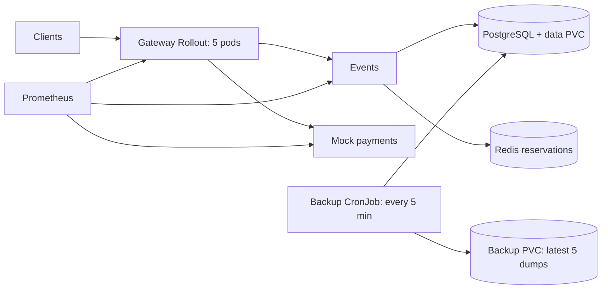

# QuickTicket SRE handbook

Training environment: k3d, simulated payments, demo credentials. Owner: Walkerino;
escalation: course instructor/TA after 10 minutes without a clear mitigation.

## Architecture



- Gateway routes reads and checkout; events owns inventory and orders.
- Redis holds expiring reservations; PostgreSQL owns durable confirmed orders.
- Local PVCs survive pod replacement, not loss of the k3d host or its disk.

## Deploy

The prior Lab 5 workflow builds each service for amd64/arm64, publishes immutable
commit-SHA image tags to ghcr.io, and updates manifest image references. For a
GitOps environment: branch from the tracked application source, change code,
open/review PR, wait for CI, merge, then allow ArgoCD to sync the committed image
references. The Rollout sends 20% to the canary, waits for canary-specific analysis,
then increases to 60% and 100%. Observe:

```bash
kubectl argo rollouts get rollout gateway
kubectl get analysisrun
kubectl get pods -l app=gateway
```

On failed analysis abort; revert the bad desired configuration in Git so self-heal
cannot restore it. A local experiment cluster has no ArgoCD controller: use
`scripts/bootstrap-lab7.sh` and `kubectl apply -k k8s` there. The referenced CI/GitOps
setup remains in the separate Lab 5 branch; bootstrap does not install it.

## Monitor

Golden signals: request rate, errors, latency and saturation. Inspect Prometheus
`up` before interpreting missing time series as success. Query:

```promql
sum(rate(gateway_requests_total[5m]))
(sum(rate(gateway_requests_total{status=~"5.."}[5m])) or vector(0))
 / sum(rate(gateway_requests_total[5m]))
histogram_quantile(0.99, sum by(le,path)(rate(gateway_request_duration_seconds_bucket[5m])))
sum by(pod)(rate(gateway_requests_total[1m]))
```

Check the Grafana golden-signals dashboard, Kubernetes readiness/endpoints and
`kubectl top pods`. Inspect checkout separately from health probes. Alert on
burn rate, slow successful checkout, no traffic/scrape, DB pool exhaustion and
backup age. 409 is inventory conflict; 5xx and connection failures are failures.

## Incident response

1. Record UTC start, impact and recent change. Preserve logs and metric ranges.
2. Check `kubectl get pods,svc,endpoints`, Rollout/AnalysisRun state, and
   `kubectl logs deploy/events --since=5m --tail=100`; distinguish DB, Redis,
   payment dependency failure from CPU throttling.
3. Abort a bad canary and revert its manifest in the GitOps source. For an
   isolated failed pod, replace that pod after collecting evidence.
4. Verify `/events`, reserve and simulated pay, all ready replicas and an error
   window free of new failures. Restart events after DB recovery if pooled
   connections are stale. Record recovery time and follow up with a postmortem.

Do not flush Redis as a production repair: active reservations would be lost.
The lab load runner flushes only its explicitly checked isolated training context.

## Backup and restore

Apply `labs/lab9/backup-storage.yaml`, then `k8s/backup-cronjob.yaml`. A manual
validation run and archive inspection:

```bash
kubectl create job --from=cronjob/postgres-backup backup-check
kubectl wait --for=condition=Complete job/backup-check --timeout=90s
kubectl logs job/backup-check
kubectl exec deploy/backup-inspector -- ls -lh /backups
```

For recovery, pause writers, copy the selected dump to the DB pod with
`kubectl cp` (verify file size and `pg_restore --list`), then run:

```bash
kubectl exec deploy/postgres -- pg_restore --exit-on-error \
  -U quickticket -d quickticket --clean --if-exists /tmp/backup.dump
kubectl rollout restart deploy/events
kubectl rollout status deploy/events --timeout=90s
kubectl exec deploy/postgres -- psql -U quickticket -d quickticket \
  -c 'SELECT count(*) FROM events; SELECT count(*) FROM orders;'
```

`--clean` replaces database objects: choose the correct archive and target first.
Verify schema revision, row counts and checkout before resuming writes. RPO is
bounded by the last successful backup snapshot, not simply the schedule. Add
external storage, backup-age alerts, periodic restore drills and WAL archiving
with PITR for a tighter recovery objective.
